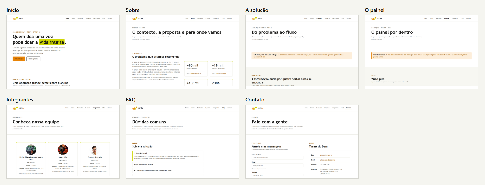
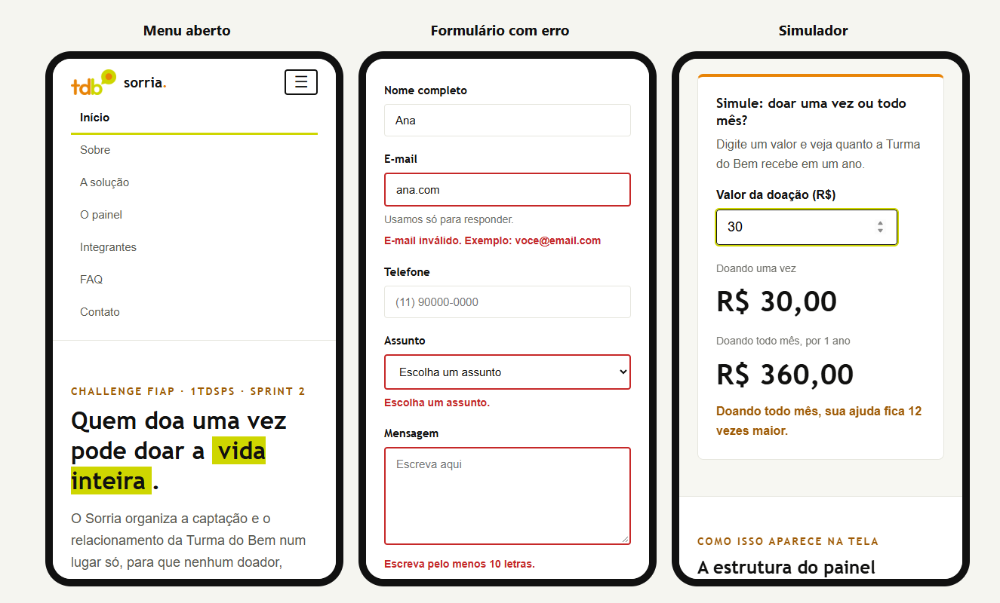
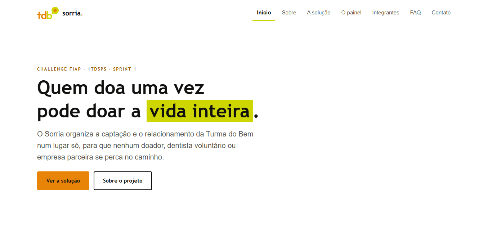
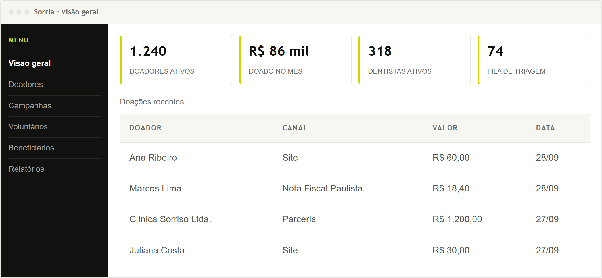
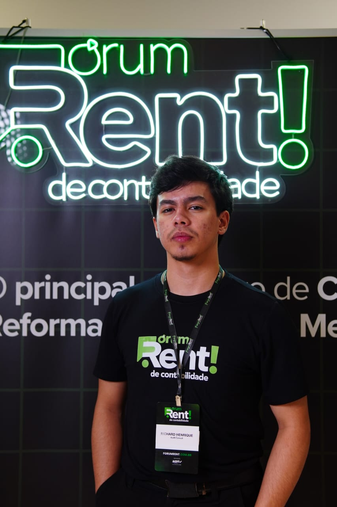
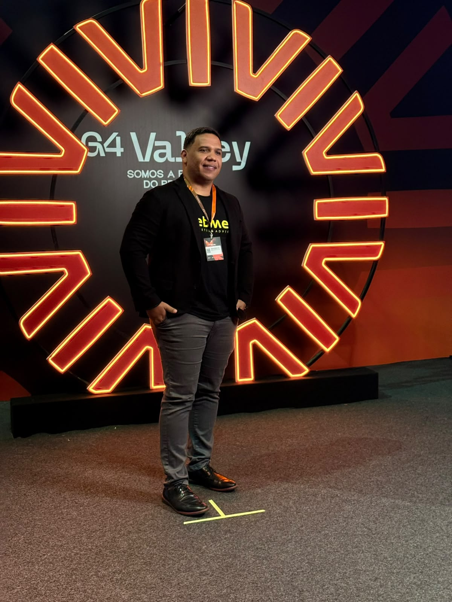
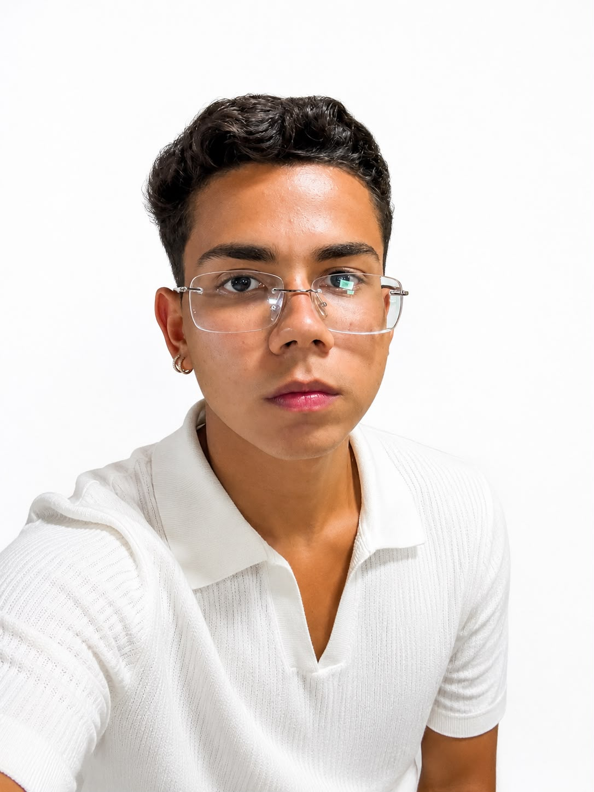
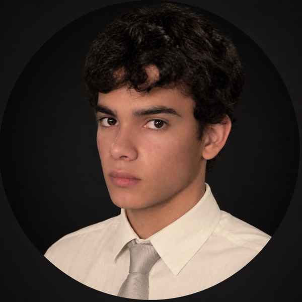

# Sorria — Challenge Turma do Bem

> Plataforma de captação e relacionamento com doadores para a ONG Turma do Bem.
> Challenge FIAP · 1TDSPS · Sprint 2 · 2026

## 🔗 Links

- **Repositório:** https://github.com/rhenrique013/challenge-turma-do-bem
- **Visualização:** https://rhenrique013.github.io/challenge-turma-do-bem/

## 🎯 Sobre o projeto

A Turma do Bem conecta dentistas voluntários a jovens de 11 a 17 anos que precisam de tratamento.
Hoje as informações de quem doa, de quem atende como voluntário e de quem é atendido ficam
espalhadas entre sistemas, planilhas e formulários.

O Sorria junta tudo num cadastro único, com o histórico de cada pessoa, para a ONG não perder
doadores e fechar a prestação de contas sem planilha manual.

Para usar, abra o link de visualização acima (ou o `index.html` no navegador) e navegue pelo menu
do topo: Início, Sobre, A solução, O painel, Integrantes, FAQ e Contato. No celular, o menu abre
pelo botão ☰.

## 🚦 Status

| Sprint | Situação | O que entrou |
|---|---|---|
| 1 | ✅ Entregue | Site estático em HTML e CSS, versão para computador, 7 páginas |
| 2 | ✅ Entregue | Site responsivo (celular, tablet e computador) e interatividade com JavaScript |
| 3 | 🔜 Próxima | Mapa do site, fluxos de navegação e personas |
| 4 | 🔜 Próxima | Solução completa funcionando de ponta a ponta |

## ✨ Funcionalidades da Sprint 2

- **Menu hambúrguer:** no celular e no tablet, o menu fica escondido e abre e fecha pelo botão ☰ (`js/menu.js`).
- **Validação do formulário de contato:** não deixa enviar com nome, e-mail, assunto ou mensagem
  vazios ou errados; mostra o aviso embaixo do campo e pinta a borda de vermelho (`js/formulario.js`).
  O formulário é demonstrativo: confere os dados, mas não envia nada.
- **Simulador de doação:** no Início, a pessoa digita um valor e vê quanto ele vira em um ano doando
  todo mês, a ideia central do Sorria (`js/simulador.js`).
- **Responsividade:** as 7 páginas se ajustam a celular (a partir de 320px), tablet (768px) e
  computador (992px e 1300px), sem rolagem para o lado.
- **Painel navegável:** os itens do menu interno do painel levam para a tela correspondente.

## 🛠 Tecnologias utilizadas

- HTML5
- CSS3 (Flexbox, Grid e media queries)
- JavaScript, sem bibliotecas
- Sem frameworks ou bibliotecas externas

## 📁 Estrutura de pastas

```
challenge-turma-do-bem/
├── index.html
├── sobre.html
├── solucao.html
├── painel.html
├── integrantes.html
├── faq.html
├── contato.html
├── css/
│   ├── style.css        base do site (cores, cabeçalho, rodapé, componentes)
│   ├── inicio.css       Início e Sobre
│   ├── equipe.css       Integrantes e FAQ
│   └── contato.css      Contato
├── js/
│   ├── menu.js          menu hambúrguer
│   ├── formulario.js    validação do contato
│   └── simulador.js     simulador de doação
├── imagens/
│   ├── logo-tdb.png
│   ├── painel.png
│   ├── print-inicio.png
│   ├── print-celular.png
│   ├── print-paginas.png
│   └── equipe/          fotos dos integrantes
└── README.md
```

## 🖼 Imagens do projeto

As imagens estão na pasta `imagens/` e no site publicado.

**As sete páginas no computador**



**As três interações no celular: menu aberto, formulário com erro e simulador**



**Página inicial**



**Esboço do painel**



## 👥 Autores

| Foto | Nome completo | RM | Turma | GitHub | LinkedIn |
|---|---|---|---|---|---|
|  | Richard Henrique dos Santos Souza | 576509 | 1TDSPS | [rhenrique013](https://github.com/rhenrique013) | [LinkedIn](https://www.linkedin.com/in/richardhenrique1312) |
|  | Diego Silva | 575925 | 1TDSPS | [Diegosilvadrs](https://github.com/Diegosilvadrs) | [LinkedIn](https://www.linkedin.com/in/diego-silva-drs) |
|  | Gustavo Andrade | 575971 | 1TDSPS | [eagu07](https://github.com/eagu07) | [LinkedIn](https://www.linkedin.com/in/gustavo-andrade-199429383) |
|  | Gustavo Rocha Batista | 570672 | 1TDSPS | [gustavo-rocha-batista](https://github.com/gustavo-rocha-batista) | [LinkedIn](https://www.linkedin.com/in/gustavo-rocha-batista) |
|  | Renato Zanchin | 576199 | 1TDSPS | [renatozftv](https://github.com/renatozftv) | [LinkedIn](https://www.linkedin.com/in/renato-zanchin-0232563a2) |

### Quem cuidou de cada parte

| Integrante | Responsável por |
|---|---|
| Richard | Base do site (`style.css`), A solução e O painel, menu hambúrguer (`menu.js`), README |
| Diego | Início e Sobre na versão para computador (`index.html`, `sobre.html`, `inicio.css`) |
| Gustavo Andrade | Integrantes, FAQ e Contato na versão para computador (`equipe.css`, `contato.css`) |
| Gustavo Rocha | Início e Sobre no celular e no tablet, simulador de doação (`simulador.js`) |
| Renato | Contato, Integrantes e FAQ no celular e no tablet, validação do formulário (`formulario.js`) |

## 📬 Contato

- Pelo GitHub ou LinkedIn de qualquer integrante (tabela acima)
- Os canais oficiais da Turma do Bem estão na página [Contato](https://rhenrique013.github.io/challenge-turma-do-bem/contato.html)
